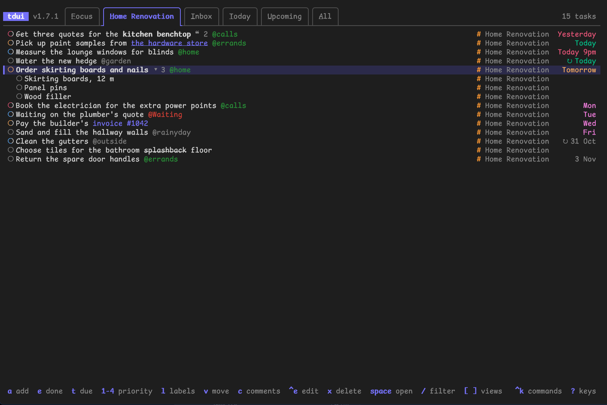
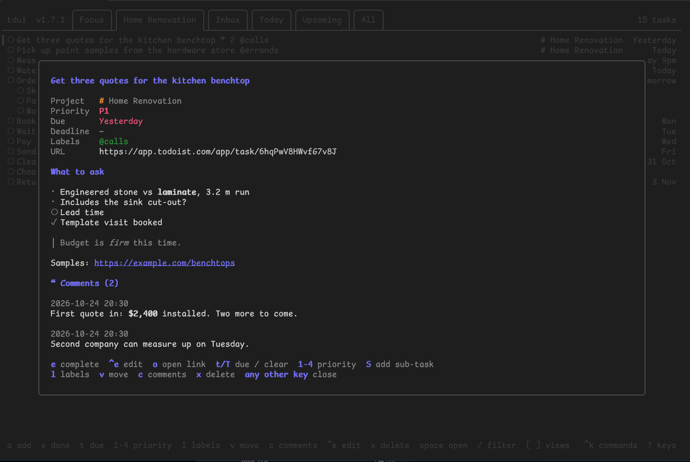
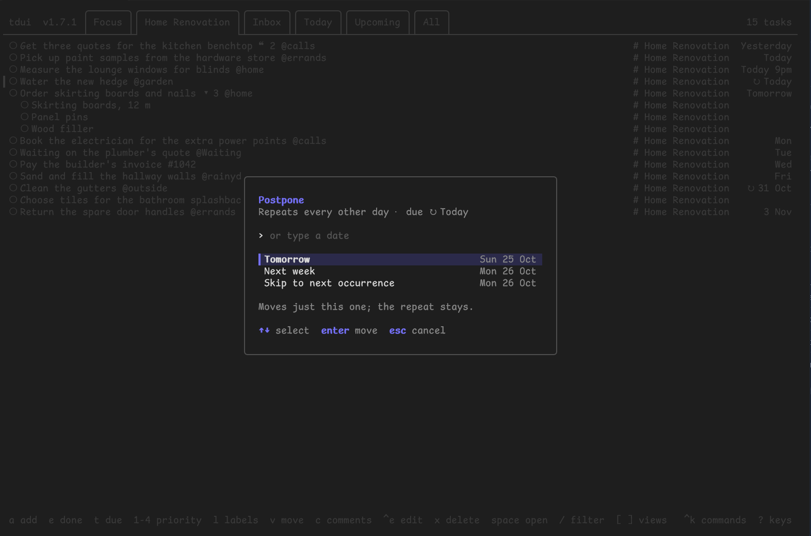
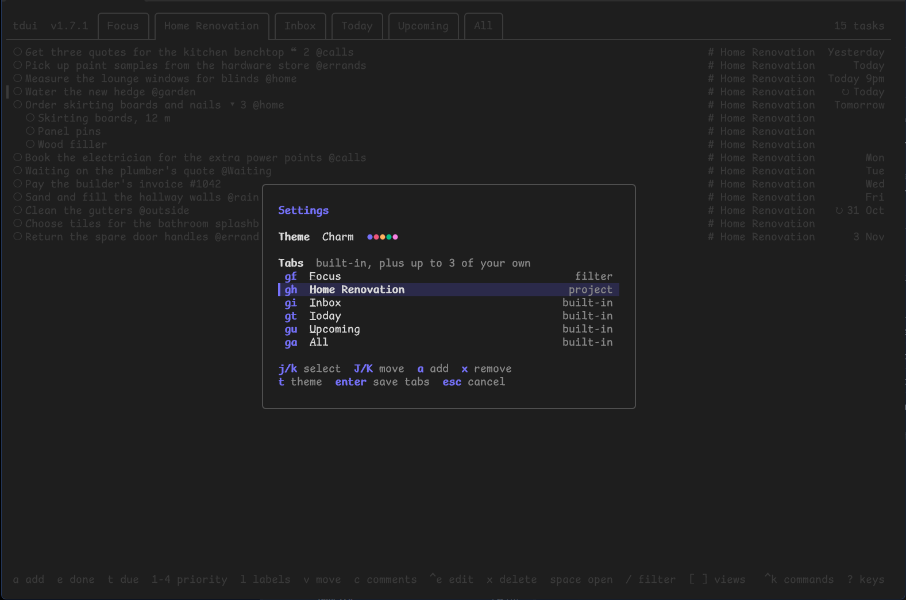
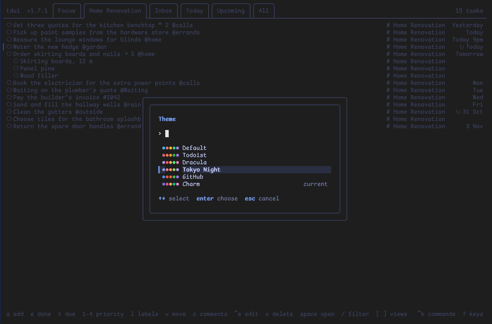

# tdui

A fast terminal UI for [Todoist](https://todoist.com). Browse your tasks by
view (Inbox, Today, Upcoming, All, plus up to three tabs of your own), a
project, or any Todoist filter, then complete, edit, reschedule,
reprioritise, move or delete them, or read and add comments, all from the
keyboard without leaving the terminal.



It talks to the Todoist API directly and caches everything it fetches, so
it opens instantly with your last known tasks while a fresh copy loads in
the background.

**[Download the latest release](https://github.com/cnxguy/tdui-releases/releases/latest)**
for macOS, Windows or Linux: a single file, nothing else to install.

This repo holds the releases only; the source isn't public yet. tdui is
free to use, and isn't affiliated with or endorsed by Doist or Todoist.

## Features

- **Quick Add** (`a`) with Todoist's natural-language syntax: dates, `p1`–`p4`,
  `#project`, `@label`. Typing `#` or `@` suggests matching projects and labels.
- **Filter or search** (`/`) with any Todoist filter (`today & #Work`,
  `p1 | @waiting`) or plain words. Project and label suggestions work here too,
  including after `(`, `!`, `&`, `|` and for `##project`.
- **Your own tabs** (`,`): add up to three saved filters, labels or projects
  as tabs, and put all the tabs in the order that suits you.
- **Command palette** (`ctrl+k` or `:`) for actions, views, projects, labels and
  themes.
- **Sub-tasks**, comments, labels, moving between projects.
- **Postpone a recurring task** (`t`): to tomorrow, next week, the next
  occurrence, or a date you type. Just this one moves; the repeat stays.
- **Priority groups** (`p`) or **section headings** (`h`), remembered per view.
  Section headings name the project too in views that span projects
  (`Home › Shopping`).
- **Productivity popup** (`i`): tasks completed today and over the last 7 days,
  goals and streaks.
- **Markdown shown formatted**, as Todoist writes it: **bold**, *italic*,
  ~~struck~~, `code` and links in task names; headings, lists, quotes and
  code blocks too in descriptions and comments. Links are clickable.
- **Themes** (`,` then `t`, or Theme in the palette): Default,
  Todoist, Dracula, Tokyo Night, GitHub and Charm. Each one is previewed as
  you move through the list, and has light and dark versions to suit the
  terminal (Alucard for Dracula, Tokyo Night Day, GitHub Light).

## A closer look

**Task details** (`space`): the description and comments with their
Markdown formatted, and every task key to hand.



**Postpone a recurring task** (`t`): move just this occurrence and keep the
repeat.



**Settings** (`,`): your own tabs and their order, each with a `g` key.



**Themes** (`,` then `t`), previewed as you move through them.



## Installing

Download the file for your machine from the
[latest release](https://github.com/cnxguy/tdui-releases/releases/latest). There's
nothing to install: it's a single program, so rename it `tdui` (`tdui.exe`
on Windows) and put it somewhere on your `PATH`.

| Machine                                 | File                        |
| --------------------------------------- | --------------------------- |
| Mac with Apple silicon (M1 and later)   | `tdui-go-darwin-arm64`      |
| Mac with an Intel processor             | `tdui-go-darwin-amd64`      |
| Windows PC                              | `tdui-go-windows-amd64.exe` |
| Windows on ARM (Snapdragon laptops)     | `tdui-go-windows-arm64.exe` |
| Linux PC or server                      | `tdui-go`                   |
| Raspberry Pi (64-bit OS), ARM Linux     | `tdui-go-linux-arm64`       |

Not sure which? On a Mac, Apple menu → About This Mac says *Chip: Apple M…*
or *Processor: Intel*. On Linux or a Mac, `uname -m` prints `arm64` or
`aarch64` for ARM and `x86_64` for Intel/AMD. On Windows, Settings → System
→ About → System type says *x64-based* or *ARM-based*.

The binaries aren't signed, so each system is wary of them the first time.

### macOS

A browser-downloaded file is quarantined: macOS says it "can't be opened
because Apple cannot check it for malicious software" or that it "was not
opened". Clear that, and make it runnable, in Terminal:

```
cd ~/Downloads
mv tdui-go-darwin-arm64 tdui        # or tdui-go-darwin-amd64 on Intel
xattr -d com.apple.quarantine tdui
chmod +x tdui
sudo mv tdui /usr/local/bin/
```

(Or run it once, then System Settings → Privacy & Security → *Open Anyway*.)
A file downloaded with `curl` isn't quarantined, so only needs the `chmod`:

```
curl -fLo tdui https://github.com/cnxguy/tdui-releases/releases/latest/download/tdui-go-darwin-arm64
chmod +x tdui
```

### Windows

- **SmartScreen** may say "Windows protected your PC": choose *More info*,
  then *Run anyway*. Or right-click the file → Properties → tick *Unblock* →
  OK before running it.
- **Defender** occasionally flags unsigned Go programs by mistake. If it
  quarantines tdui, restore it from Windows Security → Protection history.
- Run it in **Windows Terminal** (the default on Windows 11): the old console
  window shows the colours and box lines poorly.
- The token is kept in Windows Credential Manager.

### Linux

- Make it runnable: `chmod +x tdui`, then move it to `~/.local/bin` or
  `/usr/local/bin`.
- The token goes in the desktop keyring (GNOME Keyring or KWallet, through
  Secret Service). On a server or over SSH there usually isn't one, so tdui
  keeps it in `~/.config/tdui/token` (readable only by you), or set
  `TODOIST_API_TOKEN`.
- `o` (open a link) uses `xdg-open`, so over SSH it opens nothing: ctrl-click
  (or cmd-click) the link instead, as most terminals make links clickable.
- On a Raspberry Pi, `tdui-go-linux-arm64` needs the 64-bit Raspberry Pi OS
  (`uname -m` says `aarch64`); there's no 32-bit build.

### Terminal

Any modern terminal works: iTerm2, Terminal.app, Ghostty, kitty, WezTerm,
GNOME Terminal, Windows Terminal. tdui picks the light or dark version of the
theme from the terminal's background.

## Getting started

tdui needs your Todoist API token: in Todoist, Settings → Integrations →
Developer → API token, then *Copy API token*. Run `tdui` and paste it in
when asked. It's kept in your system's keychain (macOS Keychain, Windows
Credential Manager, or Secret Service on Linux), or in
`~/.config/tdui/token`, readable only by you, where there isn't one. It's only
ever sent to Todoist. You can also set `TODOIST_API_TOKEN` instead.

```
tdui            # run
tdui --logout   # forget the stored token
tdui --version  # which version this is
tdui --license  # the licence and third-party notices
```

Press `?` in tdui for every key, or `ctrl+k` for the command palette, which
lists everything you can do. Press `,` for settings: the theme and your tabs.

## Keys

```
a         add a task (Quick Add: dates, p1-p4, #project, @label)
e         complete task
t / T     set due date / clear it (recurring: postpone or skip this one)
1-4       set priority P1-P4
l         edit labels
v         move to another project
c         comments
o         open the first link in the task (its name, then description)
s / S     show or hide sub-tasks / add a sub-task
ctrl+e    edit task text and description
x         delete task
space ↵   task details

ctrl+k :  command palette (actions, views, projects, labels, search)
j/k ↑/↓   move · gg/G top/bottom · ctrl+d/u half page
[ / ]     previous / next view
g then    go to a view by its underlined letter: gi Inbox, gt Today,
          gu Upcoming, ga All, and a letter for each tab of your own
,         settings: theme (t), and tabs: add saved filters, labels or
          projects, change the order
/         filter or search (esc clears it)
p         group by priority (on/off, remembered per view)
h         section headings (on/off, remembered per view)
i         productivity: completed today and this week, goals, streaks
r         refresh
q         quit
```

In the Quick Add and filter prompts, when suggestions are showing: `↑`/`↓`
select, `tab` or `enter` inserts the name, `esc` hides the list.

## Tabs

Inbox, Today, Upcoming and All are always there. Press `,` (or pick Settings
in the palette) to add up to three tabs of your own (any saved
filter, label or project) and to change the order: `J`/`K` move the selected
tab, `a` adds one, `x` removes one of yours, `enter` saves.

Each tab's `g` letter is underlined on it. The built-in tabs keep their first
letters (`gi`, `gt`, `gu`, `ga`, as in Todoist's web app). Your own tabs take
their first letter if it's free, otherwise the first letter of another word
in the name, then any other letter in it: with a "Travel" tab next to Today,
`gr` goes to Travel. (`gg` is always the top of the list.)

## Updating

Download the new file over the old one (and on macOS clear the quarantine
again, as above). Your token, settings and tabs are kept. The version is
shown at the top left, after the name, and by `tdui --version`.

## Problems and ideas

Please [open an issue](https://github.com/cnxguy/tdui-releases/issues): say
which version you're on (`tdui --version`), your system, and your terminal.
About tdui in the command palette shows the version, the build and where
tdui keeps its files.

## Licence

tdui is free to use, and to share unmodified, provided as is with no
warranty: see [LICENSE](LICENSE). It's built with open-source libraries,
including [Bubble Tea](https://github.com/charmbracelet/bubbletea) and
[Lip Gloss](https://github.com/charmbracelet/lipgloss); their notices are in
[THIRD_PARTY_NOTICES.txt](THIRD_PARTY_NOTICES.txt), each release, and
`tdui --license`.

tdui isn't affiliated with, endorsed by or sponsored by Doist Inc. Todoist
is a trademark of Doist Inc.
